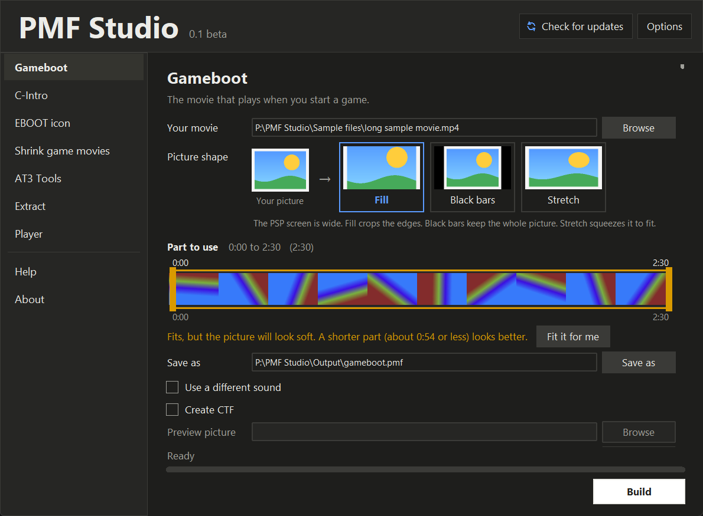

# PMF Studio

Make PSP movies, boot movies and AT3 sounds on Windows. No installer and nothing else to download: unzip it and run it.
PMF Studio is one part of the coming **PSP CTF Studio**.

More: [gameboot built](docs/screenshots/gameboot-built.png), [EBOOT icon](docs/screenshots/eboot-icon.png),
[Shrink game movies](docs/screenshots/shrink.png), [AT3 Tools](docs/screenshots/at3-tools.png), [Extract](docs/screenshots/extract.png), [Player](docs/screenshots/player.png),
[light theme](docs/screenshots/gameboot-light.png). The pictures were made with made-up sample files.

## What it does

- **Gameboot**: turns a movie into the PSP gameboot, fitted to the size the PSP can play. Optionally makes a CTF theme for CXMB,
  and lengthens the boot with your own `opening_plugin.rco`.
- **C-Intro**: a movie for the C-Intro boot plugin.
- **EBOOT icon**: changes the icon movie, the sound, the pictures and the title in a copy of a game's EBOOT.
- **Shrink game movies**: makes a game's own `.pmf` movies smaller (one movie or a whole folder): same names, picture size and
  length, you choose how much of the picture's bitrate to keep (100% to 20%, shown in kbps for your movies) and the sound quality (as it is, or 128 down to 32 kbps). Every result is checked before it is saved.
  Movies with several sound tracks (one per language) keep all of them, or you press Play to hear each track and keep only the ones you want (the others
  stay in their places but empty, so the movies get smaller; the game plays the kept language and is silent under a removed one). You can also pick a whole game (a `.cso` or `.iso` of your own backup): PMF Studio finds
  the movies inside it, shrinks them and writes a new game file in which only the movies changed and every other byte of the disc stays as it was.
- **AT3 Tools**: make an AT3 from any sound, shrink an AT3 from a game, or turn an AT3 into a WAV or MP3.
- **Extract**: takes any PMF apart into an MP4 (and its sound as AT3 and WAV).
- **Player**: plays PMF movies and sounds inside the program, with full screen.
- Picks the part of a long movie that fits (a strip with a block you drag), keeps the best quality the size limit allows, shows a
  progress bar for everything that takes time, light and dark themes.
- Drag and drop: drop a movie, EBOOT.PBP, PMF, sound or folder on the window (or on the exe) and it lands in the right box.
- Stop button, checks before a job (free space, odd names, saving over your own file), working files cleaned up.
- Updates itself when you ask: downloads the new release, verifies its SHA-256, tests it, swaps it in, and rolls back if that fails.
- C-Intro movies of any length: written to disk a piece at a time, so a 2-hour movie needs no more memory than a 2-minute one.
- Portable: it saves nothing outside its own folder, and you can move or rename the folder.

## Download and use

Get the zip from the Releases page, unzip anywhere, run `PMF Studio.exe`. Windows may warn that the program isn't signed: choose
*More info*, then *Run anyway*. The release notes list the SHA-256 of the zip.

## Status

Beta. Everything was checked on one PSP (firmware 6.61 with ARK-5 and CXMB). Not tested yet on a PSP: movies for the C-Intro
plugin.

Keeping only some sound tracks of a game's movies worked in 007 From Russia With Love (English played with sound, the removed languages played silent, no crash); the window's picker for it has not been run on a PSP yet.

Smaller game movies have run inside real games: 007 From Russia With Love and Family Guy at 50% picture, and Gun Showdown,
shrunk with the whole game at the lowest picture (20%) and sound (32 kbps) settings, played through its start-up logos and the
first Story movies. Shrinking keeps each movie built the way the game's own movie was (B-frames or not, reference frames, where
the pictures start, buffer sizes, jump-point list) and changes only the bitrate. An earlier build that forced B-frames and
2 reference frames at the lowest picture setting crashed Gun Showdown, so that is not offered in the window. Whether a given
game accepts smaller movies is still up to the game: try the new game before you delete anything, and start with a milder
choice if it fails. When it shrinks a whole game it also empties Sony's UPDATE folder (the firmware-update offer, useless on
custom firmware) and never touches the game's XMB icon. The size limits come from tests on that PSP and may differ on other setups.

## Running from the source

Needs Python 3.12 (standard library only for the program itself), plus `ffmpeg.exe` and `atracdenc.exe` in a `tools` folder.
Start it with `python -m pmfstudio`. Tests: `python -W ignore -m unittest discover -s tests -t .`.
`python packaging/build_release.py` builds the release folder and zip (see the notes at the top of that file).

## Credits

Built with help from Claude (Anthropic); designed and tested by Mr-Shizzy.

## Licence

PMF Studio is copyright (C) 2026 Mr-Shizzy and released under the GNU General Public License, version 3 (see `LICENSE`): you may use, share and
change it, but a program built from it must stay open under the same licence, with credit kept. The release also contains FFmpeg (GPL) and atracdenc
(LGPL-2.1), which keep their own licences: see `THIRD_PARTY_NOTICES.txt`. Not affiliated with Sony. Includes no copyrighted game
content: bring your own files.
